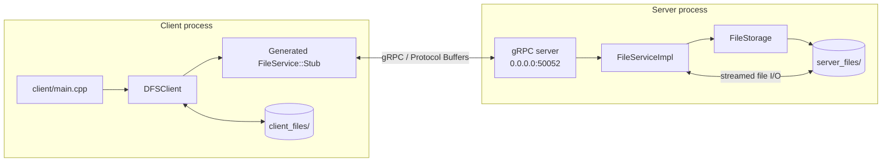

# DFS_Custom — Distributed File System Using gRPC

## 1. Project Overview

DFS_Custom is a learning-oriented C++17 project that implements remote file
storage through gRPC. A command-line client uploads, downloads, deletes, lists,
and inspects files held by a single server.

Protocol Buffers defines the messages and service contract. Generated C++ code
provides message serialization, a client stub, and the server service interface.
gRPC carries requests and responses between the two processes, including
streamed file contents.

**This is a gRPC-based remote file storage application and a foundation for
learning distributed file systems, not a production-ready DFS.** The current
implementation has no multi-node replication, automatic synchronization,
distributed coordination, or filesystem mount interface.

## 2. Features

| Operation | Implemented behavior |
| --- | --- |
| Store | Streams a local file to the server, writes a temporary file, then renames it to the requested filename. |
| Fetch | Streams a remote file into the client's local storage directory. |
| Delete | Removes a regular file from remote storage; does not delete the client's copy. |
| List | Returns metadata for regular, non-symlink files directly inside server storage. |
| Stat | Returns filename, size in bytes, modification time, and a creation-time placeholder. |

Uploads from the supplied client and downloads from the server use chunks of up
to **64 KiB**. Binary contents are supported. Store can replace an existing
remote file on macOS; Fetch overwrites an existing local file. Empty-file
uploads are not supported by the current client.

## 3. Architecture



- **CLI:** validates command names and argument counts, chooses the server
  address, and reports RPC failures.
- **DFSClient:** opens local files, performs synchronous RPC calls through the
  generated stub, and prints results.
- **Generated stub:** exposes typed calls to `dfs.FileService`.
- **gRPC server:** listens for requests and dispatches them to the registered
  service implementation.
- **FileServiceImpl:** implements the five RPC handlers, streaming I/O,
  temporary upload handling, and gRPC status responses.
- **FileStorage:** owns the storage root and implements filename validation,
  path construction, deletion, metadata lookup, and directory listing.

Separating filesystem helpers from RPC handling keeps storage policy independent
of transport-specific request and response types. Streaming file reads and
writes still live in FileServiceImpl; FileStorage is not a separate storage
service or node.

The channel is constructed as follows in the client:

```cpp
auto channel = grpc::CreateChannel(
    serverAddress,
    grpc::InsecureChannelCredentials()
);
```

The server likewise uses insecure credentials. Neither side enables TLS.

## 4. Repository Structure

The current working directory contains the following files and artifacts.
CMake internals under the build directory are abbreviated.

```text
DFS_Custom/
├── .gitignore
├── CMakeLists.txt
├── README.md
├── client/
│   ├── DFSClient.h
│   ├── DFSClient.cpp
│   └── main.cpp
├── server/
│   ├── FileStorage.h
│   ├── FileStorage.cpp
│   ├── FileServiceImpl.h
│   ├── FileServiceImpl.cpp
│   └── main.cpp
├── proto/
│   └── dfs_service.proto
├── generated/
│   ├── dfs_service.pb.h
│   ├── dfs_service.pb.cc
│   ├── dfs_service.grpc.pb.h
│   └── dfs_service.grpc.pb.cc
├── client_files/
│   ├── test.txt
│   └── test_original.txt
├── server_files/                 # Currently empty
└── build/
    ├── CMakeCache.txt
    ├── Makefile
    ├── cmake_install.cmake
    ├── CMakeFiles/               # Generated build internals
    ├── dfs_client
    ├── dfs_server
    └── libdfs_proto.a
```

| File or group | Purpose |
| --- | --- |
| [proto/dfs_service.proto](proto/dfs_service.proto) | Manually written service and message definitions. |
| [client/DFSClient.h](client/DFSClient.h), [client/DFSClient.cpp](client/DFSClient.cpp) | Client API, local file transfers, and result printing. |
| [client/main.cpp](client/main.cpp) | CLI parsing, channel construction, command dispatch, and exit status. |
| [server/FileStorage.h](server/FileStorage.h), [server/FileStorage.cpp](server/FileStorage.cpp) | Storage root, filename checks, filesystem operations, and metadata. |
| [server/FileServiceImpl.h](server/FileServiceImpl.h), [server/FileServiceImpl.cpp](server/FileServiceImpl.cpp) | Concrete gRPC service and RPC implementations. |
| [server/main.cpp](server/main.cpp) | Server startup, fixed listen address, and fixed storage-directory setting. |
| [CMakeLists.txt](CMakeLists.txt) | C++17 configuration and the `dfs_proto`, `dfs_server`, and `dfs_client` targets. |
| [.gitignore](.gitignore) | Excludes build output, generated code, local storage, and editor/platform artifacts. |
| `generated/dfs_service.pb.*` | Protobuf message code generated by `protoc`. |
| `generated/dfs_service.grpc.pb.*` | Service and stub code generated by `protoc` with `grpc_cpp_plugin`. |

The client, server, schema, and CMake configuration are handwritten. Do not
manually edit generated code. The generated, build, and storage directories
exist locally but are ignored by Git and should not be expected in a fresh
clone.

## 5. Protocol Buffers and RPC Definitions

The schema uses `proto3`, package `dfs`, and service `FileService`:

```protobuf
service FileService {
    rpc Store(stream FileChunk) returns (StoreResponse);
    rpc Fetch(FileRequest) returns (stream FileChunk);
    rpc Delete(FileRequest) returns (DeleteResponse);
    rpc List(ListRequest) returns (ListResponse);
    rpc Stat(FileRequest) returns (FileInfo);
}
```

| RPC | Request | Response | Communication type |
| --- | --- | --- | --- |
| Store | Stream of `FileChunk` | `StoreResponse` | Client streaming |
| Fetch | `FileRequest` | Stream of `FileChunk` | Server streaming |
| Delete | `FileRequest` | `DeleteResponse` | Unary |
| List | `ListRequest` | `ListResponse` | Unary |
| Stat | `FileRequest` | `FileInfo` | Unary |

- **Unary:** one request and one response.
- **Client streaming:** multiple request messages followed by one response.
- **Server streaming:** one request followed by multiple response messages.

| Message | Fields |
| --- | --- |
| `FileChunk` | `string filename`, `bytes data` |
| `FileRequest` | `string filename` |
| `StoreResponse` | `string filename`, `int64 modified_time` |
| `DeleteResponse` | `string filename` |
| `ListRequest` | Empty message |
| `FileInfo` | `string filename`, `int64 size`, `int64 modified_time`, `int64 created_time` |
| `ListResponse` | `repeated FileInfo files` |

Every upload chunk must carry the same filename; at least one chunk is required.
Modification time is the server filesystem's `st_mtime`, expressed as Unix
epoch seconds, not a preserved client timestamp. `created_time` is always **0**
because birth/creation time is not implemented. List prints filename, size, and
modification time; Stat also prints the creation-time placeholder.

## 6. Prerequisites

- C++17-compatible compiler with `std::filesystem` support.
- CMake **3.16 or newer** and a supported build tool.
- Protocol Buffers compiler (`protoc`) and C++ development libraries.
- gRPC C++ development libraries and `grpc_cpp_plugin`.
- Compatible Protobuf and gRPC installations with CMake package configurations.

### macOS with Homebrew

Install Apple's command-line tools if they are not already installed:

```bash
xcode-select --install
```

With [Homebrew](https://brew.sh/) installed:

```bash
brew install cmake protobuf grpc
"$(brew --prefix protobuf)/bin/protoc" --version
test -x "$(brew --prefix grpc)/bin/grpc_cpp_plugin"
cmake --version
```

The official formula names are [protobuf](https://formulae.brew.sh/formula/protobuf)
and [grpc](https://formulae.brew.sh/formula/grpc); the latter provides
`grpc_cpp_plugin`. The commands below select Homebrew tools explicitly so an
unrelated Conda or system installation does not supply the code generators.

The storage implementation uses POSIX `stat`; these instructions target macOS.
A C++17 compiler alone does not establish native Windows support.

## 7. Build Instructions

Obtain the repository and enter its root. No repository URL is assumed here:

```bash
cd DFS_Custom
```

Run subsequent commands from this directory. Do not reuse another machine's
build cache or binaries.

### Generate the C++ sources manually

The current CMake configuration **does not run `protoc`**. It compiles existing
generated sources, so generate them before configuring a fresh checkout:

```bash
mkdir -p generated

"$(brew --prefix protobuf)/bin/protoc" \
  --proto_path=proto \
  --cpp_out=generated \
  --grpc_out=generated \
  --plugin=protoc-gen-grpc="$(brew --prefix grpc)/bin/grpc_cpp_plugin" \
  proto/dfs_service.proto
```

This creates the four files shown under `generated/`. Regenerate them whenever
the schema or Protobuf/gRPC toolchain changes. The current local Protobuf header
checks for its exact generating runtime version; stale generated code can fail
to compile against a different installation.

### Configure and compile

```bash
cmake -S . -B build \
  -DCMAKE_PREFIX_PATH="$(brew --prefix)" \
  -DProtobuf_DIR="$(brew --prefix protobuf)/lib/cmake/protobuf" \
  -DgRPC_DIR="$(brew --prefix grpc)/lib/cmake/grpc"

cmake --build build --parallel
```

For the usual single-configuration macOS generator, the executables are
`build/dfs_server` and `build/dfs_client`. CMake also builds the `dfs_proto`
library from the generated sources. There are no test targets or installation
rules defined in the current configuration.

If an existing cache points to another toolchain, configure a separate directory
such as `build-homebrew` using the same options and build it instead. Adjust
executable paths accordingly; `.gitignore` currently excludes `build/`, not
every possible custom build directory.

## 8. Running the Server

From the repository root, start the server in a dedicated terminal:

```bash
./build/dfs_server
```

The server listens on **`0.0.0.0:50052`**, meaning all IPv4 interfaces on TCP port
50052. It creates `server_files/` if necessary and resolves that directory to an
absolute path at startup. The directory is relative to the process's working
directory, not the executable's location.

The listen address and storage directory are hardcoded; there are no server
CLI options to change them. The process waits for requests until stopped, for
example with Ctrl+C. A failed gRPC startup prints an error, but the current
`main` still returns exit code 0; check the startup output rather than relying
on that exit code.

## 9. Running the Client

Run the client from the repository root so it uses the intended `client_files/`
directory. Its constructor creates that directory if it is missing.

```text
dfs_client store <filename> [server_address]
dfs_client fetch <filename> [server_address]
dfs_client delete <filename> [server_address]
dfs_client stat <filename> [server_address]
dfs_client list [server_address]
```

Commands are lowercase. The default server is `localhost:50052`.

```bash
./build/dfs_client store test.txt
./build/dfs_client fetch test.txt
./build/dfs_client list
./build/dfs_client stat test.txt
./build/dfs_client delete test.txt
```

Store reads `client_files/<filename>`; Fetch writes to that location. Pass a
basename such as `test.txt`, **not** `client_files/test.txt` or an absolute path.
There is no separate local-path or remote-name argument.

To choose another server, pass `host:port` as the last argument:

```bash
SERVER_ADDRESS="localhost:50052"  # Replace with the desired host and port.
./build/dfs_client store test.txt "$SERVER_ADDRESS"
./build/dfs_client fetch test.txt "$SERVER_ADDRESS"
./build/dfs_client list "$SERVER_ADDRESS"
./build/dfs_client stat test.txt "$SERVER_ADDRESS"
./build/dfs_client delete test.txt "$SERVER_ADDRESS"
```

List takes the address immediately after `list`; it has no filename argument.
Successful operations return exit code 0. Invalid CLI arguments or a non-OK
operation status return 1. RPC errors are printed as
`RPC failed: <numeric code> - <message>`.

## 10. End-to-End Example

Keep the server running as described above. In a second terminal at the
repository root, run the following. Use a different basename if `dfs_demo.txt`
already contains data you want to keep, locally or on the server.

```bash
mkdir -p client_files
printf 'Hello from DFS_Custom\n' > client_files/dfs_demo.txt
cp client_files/dfs_demo.txt client_files/dfs_demo_original.txt

./build/dfs_client store dfs_demo.txt
./build/dfs_client list

# Fetch replaces the local demo file with the server's copy.
./build/dfs_client fetch dfs_demo.txt
cmp client_files/dfs_demo_original.txt client_files/dfs_demo.txt
cat client_files/dfs_demo.txt

./build/dfs_client stat dfs_demo.txt
./build/dfs_client delete dfs_demo.txt
./build/dfs_client list
```

`cmp` produces no output and returns 0 when the contents match. This is a manual
comparison, not an integrity check implemented by the application. Stat reports
the file's size and server modification time, with `Created: 0`. After Delete,
the demo filename disappears from the remote listing; both local files remain.
Other files already on the server remain visible.

## 11. Testing Across Two Macs

Both Macs need the source, prerequisites, generated code, and their own build.
Do not copy a CMake cache or assume binaries are portable across architectures.

### Mac 1: server

Connect both machines to the same trusted local network. From Mac 1's repository
root:

```bash
./build/dfs_server
```

In another terminal, identify the active network interface and its address:

```bash
networksetup -listallhardwareports
ipconfig getifaddr en0
```

`en0` is an example interface, not a universal Wi-Fi interface name. Use the
device listed for the active connection. Alternatively, inspect the IP address
in macOS System Settings under Network or Wi-Fi connection details.

### Mac 2: client

From Mac 2's repository root, enter the actual IPv4 address obtained on Mac 1:

```bash
read -r -p "Mac 1 IPv4 address: " SERVER_IP
SERVER_ADDRESS="${SERVER_IP}:50052"

nc -vz "$SERVER_IP" 50052
mkdir -p client_files
printf 'Hello from Mac 2\n' > client_files/mac2_demo.txt

./build/dfs_client store mac2_demo.txt "$SERVER_ADDRESS"
./build/dfs_client list "$SERVER_ADDRESS"
./build/dfs_client fetch mac2_demo.txt "$SERVER_ADDRESS"
./build/dfs_client stat mac2_demo.txt "$SERVER_ADDRESS"
./build/dfs_client delete mac2_demo.txt "$SERVER_ADDRESS"
```

Run this block in Bash (`bash` if your terminal defaults to zsh). Choose another
demo filename if needed to avoid overwriting existing data.

- Allow incoming connections for the server executable if the macOS firewall
  prompts; ensure TCP port **50052** is accessible.
- Guest Wi-Fi, access-point client isolation, VPN routing, or firewall rules can
  prevent communication even when both machines have internet access.
- `nc` checks TCP reachability, not RPC correctness.
- Use Mac 1's reachable address, not `localhost` or `0.0.0.0`, on Mac 2.
- Do not expose this unauthenticated, unencrypted service to the public internet.

## 12. Error Handling and Limitations

### Status codes

| Status | Value | Use in the current implementation |
| --- | --- | --- |
| `OK` | 0 | Successful operation. |
| `CANCELLED` | 1 | Server detects upload/download cancellation, a failed download stream write, or cancellation while filling List results. |
| `INVALID_ARGUMENT` | 3 | Server rejects invalid filenames, destination symlinks, changed upload filenames, or an upload with no chunks. Fetch also maps exceptions during path resolution to this code. |
| `NOT_FOUND` | 5 | Missing/unopenable local upload file; missing/unopenable remote fetch; Delete/Stat cannot find a regular file or metadata. |
| `INTERNAL` | 13 | Temporary/local file creation failures, server read/write failures, filesystem exceptions in applicable handlers, or uploaded metadata lookup failure. |

gRPC itself can also return transport statuses such as `UNAVAILABLE` (14) when
the endpoint cannot be reached. These are distinct from statuses explicitly
returned by application code. Error classification is not uniform: Fetch can
report `NOT_FOUND` for an open failure unrelated to absence, and Stat can report
`NOT_FOUND` when the POSIX metadata call fails.

### Known limitations

- **Single-node storage:** no replication, synchronization, distributed locks,
  failover, versions, or conflict resolution.
- **Concurrency:** there are no per-file locks. Uploads of the same filename
  share `<filename>.uploading`; simultaneous operations can race. List and Stat
  do not provide a consistent snapshot.
- **Temporary uploads:** List does not exclude `.uploading` files, so in-progress
  or abandoned uploads can appear as ordinary files. The suffix is not reserved,
  and there is no startup cleanup. Error paths attempt removal but ignore
  cleanup errors; process termination can leave temporary files.
- **Atomicity and durability:** a same-filesystem rename on macOS provides an
  atomic destination-name replacement, but not a transaction across concurrent
  requests. Upload close/flush errors are not checked, there is no `fsync`, and
  metadata failure after rename can report an error even though the file was
  already installed. No crash-durability guarantee is provided.
- **Filename and path checks:** the server rejects empty names, `.`/`..`, path
  separators, embedded NUL, and an existing symlink at the requested destination.
  The client does not perform equivalent validation before local file access.
  Checks and later opens are separate operations, and the upload temporary path
  does not receive the destination's symlink check. These are not race-free
  filesystem confinement guarantees. Fetch does not explicitly require a
  regular file before opening, unlike Delete and Stat.
- **Empty files and local I/O:** the client sends no chunks for an empty upload,
  causing `INVALID_ARGUMENT`. It does not check local upload read errors or
  download write/close errors, so an OK RPC status alone does not prove complete
  local I/O.
- **Partial downloads:** Fetch truncates/creates the local destination before
  learning the final RPC status. Failed downloads can replace existing contents
  with an empty or partial file; there is no temporary download file or rollback.
- **Security:** insecure credentials mean no TLS encryption, peer
  authentication, or application authorization. Any reachable client can
  request the exposed operations.
- **Streaming reliability:** no application-configured deadlines, resumable
  transfers, retry policy, checksum, expected byte count, or sequence numbers.
  Cancellation checks are partial; Delete and Stat do not inspect cancellation.
- **Metadata and scale:** creation time is a zero placeholder; timestamps are
  not preserved from uploads. List is nonrecursive, unsorted, unpaginated, and
  returned in one message. There are no application quotas or file-size limits;
  library and filesystem limits still apply.
- **Startup and tests:** filesystem setup exceptions are not handled at process
  startup. The repository has sample files but no automated test suite or CTest
  registration.

## 13. Future Improvements

The following are **planned improvement directions, not implemented features**:

- Automatic file synchronization using change detection and reconciliation.
- Multi-client concurrency control with safe per-upload temporary files.
- File versioning and conflict resolution.
- Checksums and end-to-end integrity verification.
- TLS encryption, peer authentication, and authorization.
- Reliable streaming with deadlines, checked local I/O, retries/resumption, and
  atomic download replacement.
- Automated unit, RPC integration, cancellation, and concurrent-operation tests.
- Replication across multiple storage nodes, with consistency and failure
  recovery policies.

## 14. Learning Outcomes

This project demonstrates:

- Defining typed RPC contracts with Protocol Buffers.
- Generating and linking C++ message, stub, and service code.
- Implementing synchronous unary and streaming gRPC operations.
- Connecting client and server processes locally and across a LAN.
- Reading and writing binary files in bounded chunks.
- Working with C++17 filesystem paths and POSIX file metadata.
- Separating CLI, client transport, server RPC handling, and storage helpers.
- Recognizing the additional reliability, security, and coordination work needed
  to evolve remote file storage into a distributed file system.
